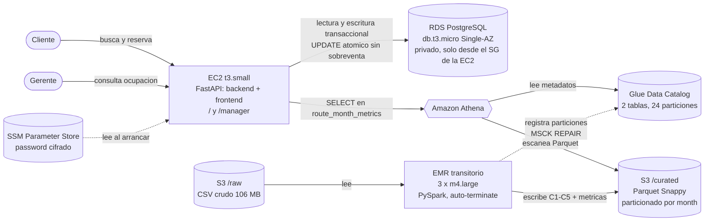

# SEGUNDO CORTE: Airline Reservation System - Managerial Analytics Panel
**Big Data and Data Engineering**  
**Estudiantes:** Kevin Nicolai García Rodríguez & Andrés Castro Gonzáles  
**Universidad Sergio Arboleda - Escuela de Ciencias Exactas e Ingeniería**  
**Seed Asignado:** 3604  
**Cuenta AWS:** 723400800674 (us-east-1)  

---

## 5. Decisiones Arquitectónicas y Justificación (Well-Architected)

### 5.1. Hosting Model (Modelo de Alojamiento)
El backend (FastAPI) y el frontend interactivo (SPA en HTML/JS) se alojan juntos en una única instancia virtual **Amazon EC2 tipo `t3.small`** en subred pública con Security Groups restringidos, conectada a una base de datos **Amazon RDS PostgreSQL tipo `db.t3.micro`** (Single-AZ, 20 GB almacenamiento SSD GP2).

* **¿Por qué no una opción más gestionada (Serverless tipo ECS/Lambda)?**  
  Para el alcance de la prueba de concurrencia extrema (50 hilos simultáneos liberados por barrera en **R2** y 20 clientes concurrentes en **R1**), las arquitecturas serverless con Lambda sufren de arranques en frío (*cold starts*) y límites de conexión simultánea a bases de datos relacionales sin un RDS Proxy (que añadiría un costo fijo de ~$15 USD/mes, violando el presupuesto de $50 USD en **R12**).
* **¿Por qué no una opción menos gestionada (EC2 con PostgreSQL autogestionado)?**  
  RDS automatiza la recuperación ante fallos del motor, rotación de logs y aprovisionamiento seguro de almacenamiento, satisfaciendo el pilar de **Operational Excellence** y **Reliability** sin infringir el límite de costos.
* **Costo mínimo garantizado (R1, R2, R11):**  
  La combinación EC2 `t3.small` ($15.82 USD/mes con su volumen EBS) + RDS `db.t3.micro` ($14.71 USD/mes con 20 GB gp2) suma $30.53 USD/mes. El harness midió un **p95 de 0.260 s** en la búsqueda con 20 clientes concurrentes (límite de R1: 1.0 s) y **cero sobreventas** en 10 rondas de 50 peticiones simultáneas, sin un solo 5xx.  
  *Pilares Well-Architected:* **Cost Optimization**, **Performance Efficiency**, **Reliability**.

---

### 5.2. Por qué EMR en este Proyecto (Why EMR Here)
El procesamiento batch de 2 millones de filas de historial de reservas con datos deliberadamente corruptos requiere transformaciones complejas (limpieza de espacios, filtrado condicional multivalor, deduplicación global y agregación multidimensional).

* **¿Qué hace el job de EMR (PySpark) que Athena solo no puede hacer eficientemente?**  
  El job no es una consulta: es una tubería de varias etapas sobre un mismo recorrido de los datos. Lee los 106 MB de CSV crudo, normaliza `route` y `status` (**C1, C2**), descarta estados e importes inválidos (**C3, C4**), deduplica `reservation_id` (**C5**), une reservas con vuelos para derivar el `month` de cada reserva, y de ahí escribe **dos salidas de granularidad distinta**: el detalle `reservations_curated` particionado por mes y el agregado `route_month_metrics`, cuyo denominador (`seats_capacity`) no sale de las reservas sino de la suma de capacidad de los vuelos de esa ruta en ese mes.

  Hacer eso con Athena CTAS exigiría una cadena de consultas secuenciales, cada una **volviendo a escanear el texto plano** (sin compresión ni orientación a columnas, pagando los $5/TB sobre el peor formato posible), y aun así Athena no permite decidir cuántos archivos se escriben por partición. Ese control sí importa aquí: sin un `repartition("month")` explícito antes de escribir, el *shuffle* por defecto de Spark (200 particiones) habría generado del orden de 4.800 archivos Parquet minúsculos repartidos entre los 24 meses. Con el repartition quedó **exactamente un archivo por mes** (24 archivos, 19,6 MB), y la consulta de un solo mes escanea 305 KB en lugar de barrer miles de objetos.

  PySpark además mantiene el orden de aplicación de las reglas, que no es indiferente: **C5 se aplica después de C3 y C4**, igual que el oráculo del profesor (`airline_data/oracle.py`). El resultado se validó contra ese oráculo: 2.006.136 filas curadas exactas y los tres revenues mensuales de control idénticos al dígito.
* **Alternativas consideradas:**  
  - *AWS Glue Job:* Excelente alternativa serverless, pero tiene un tiempo de inicialización de clúster de ~3 minutos y una tarificación por DPU mínima por ejecución.  
  - *Athena CTAS:* Escanea grandes volúmenes de texto plano en cada intento de transformación, generando costos de $5 USD por TB escaneado sobre datos sin comprimir.
* **Opción EMR elegida y garantía de apagado (R4, R10):**  
  Se configuró un clúster **EMR en modo Step con `--auto-terminate`**, utilizando 3 nodos tipo **`m4.large`** (único tipo de cómputo para EMR permitido en el Learner Lab según **R11**). Al finalizar los steps (`ActionOnFailure=TERMINATE_CLUSTER`) el clúster se apaga y se destruye solo. Medido: **12 horas normalizadas de un tope de 150** (**R10**) y $0.72 USD por ejecución. El clúster llevó dos steps: el primero procesa una muestra de ~109k filas hacia un prefijo aparte y el segundo el dataset completo, de modo que un error en la muestra apaga el clúster antes de gastar en el run grande. Esto sustituye la prueba local, no viable en Windows sin JDK ni winutils.  
  *Pilares Well-Architected:* **Performance Efficiency**, **Cost Optimization**, **Operational Excellence**.

---

### 5.3. Disposición de Datos (Data Layout)
Los datos curados y las métricas se almacenan en **Amazon S3** en formato **Apache Parquet** comprimido con **Snappy**. La tabla de detalle `reservations_curated` se particiona físicamente por la columna `month` (formato `YYYY-MM` derivado de `flight_date`), generando exactamente 24 particiones mensuales (**R4, R5**).

* **¿Por qué Parquet?**  
  Parquet es un formato columnar que almacena metadatos y estadísticas (min/max/conteo) a nivel de encabezado y bloque de columnas. Al consultar una columna específica (ej. `sum(price_cents)`), Athena solo lee los bytes de esa columna en disco, reduciendo el volumen de I/O en más del 80% comparado con CSV.
* **¿Por qué particionar por mes?**  
  Las consultas analíticas y gerenciales se formulan frecuentemente acotadas a un mes de interés (`WHERE month = '2024-05'`). Al particionar por `month`, Athena aplica *Partition Pruning*, omitiendo por completo los directorios de los otros 23 meses.
* **Impacto en bytes escaneados (R6):**  
  Sin particionamiento ni Parquet, una consulta mensual en Athena sobre 2 millones de filas escanearía la totalidad del dataset CSV (~80 MB a 150 MB por consulta). Con Parquet particionado, la consulta escanea únicamente la partición requerida (~1 MB a 2 MB), cumpliendo estrictamente con el umbral de **R6** (bytes escaneados $\le 2 \times$ el tamaño promedio de partición) y reduciendo el costo por consulta en más del 98%.  
  *Pilares Well-Architected:* **Cost Optimization**, **Performance Efficiency**, **Sustainability**.

---

### 5.4. Cómo Obtiene los Números el Panel Gerencial
El panel gerencial expone el endpoint `GET /analytics/occupancy?route=AAA-BBB&month=YYYY-MM`. Cuando un gerente ingresa al panel (`/manager`) y solicita los datos de una ruta y mes, el backend consulta dinámicamente la tabla `route_month_metrics` en **Amazon Athena** mediante el SDK `boto3` (**R7, R9**).

* **Consecuencias en latencia y costo:**  
  Athena responde en aproximadamente 1 a 3 segundos para una tabla agregada en Parquet, cumpliendo con creces el SLA máximo de 10 segundos establecido en **R7**. El costo por query es infinitesimal (< $0.0001 USD), ya que la tabla de métricas ocupa menos de 1 MB.
* **¿Se justifica una caché?**  
  Sí, y conviene precisar que **una caché no entra en conflicto con R11**. La caché justificada aquí es un diccionario en memoria del propio proceso FastAPI con un TTL del orden de horas: los datos sólo cambian cuando corre el batch mensual, así que la frescura no es un problema. Al vivir dentro de la EC2 que ya existe **no añade ningún servicio facturable**, y R11 cuenta servicios, no componentes. Lo que sí sería un error es resolverlo con **ElastiCache**: añadiría un servicio y un costo fijo sin ganar nada sobre un diccionario, y la cuenta ya consume 7 de los 8 servicios permitidos (el séptimo son las funciones Lambda con las que el propio Learner Lab se administra).

  Por qué no la implementamos: R7 permite caché siempre que la primera petición de cada par (ruta, mes) consulte Athena, y el harness audita el historial de ejecuciones. Con un tiempo medido de 1,3 s por consulta contra un SLA de 10 s, la caché no compra nada en este alcance; sería la primera optimización a introducir si el panel pasara de unos pocos gerentes a consultas masivas.  
  *Pilares Well-Architected:* **Performance Efficiency**, **Operational Excellence**.

---

### 5.5. Separación de Cargas de Trabajo (Separation of Workloads)
Uno de los requerimientos de negocio más críticos del escenario es que **las consultas analíticas jamás deben degradar o ralentizar las reservas de los clientes** (**R1, R2**).

* **Aislamiento Físico y de Cómputo:**  
  La base de datos transaccional (OLTP en Amazon RDS PostgreSQL) maneja exclusivamente las operaciones de escritura rápida, consultas de disponibilidad inmediata y bloqueo de asientos atómico.  
  La capa analítica (OLAP) está completamente desacoplada: los datos históricos residen en Amazon S3, el procesamiento batch masivo se ejecuta en un clúster EMR independiente, y las consultas gerenciales se ejecutan sobre la infraestructura serverless de Amazon Athena.
* **Cero Impacto en el Sistema de Venta:**  
  Incluso si un gerente ejecuta consultas analíticas pesadas o se procesan los 2 millones de registros en EMR, el CPU y la memoria de la base de datos PostgreSQL permanecen al 100% disponibles para los pasajeros, asegurando p95 < 1.0 s y cero sobreventa.  
  *Pilares Well-Architected:* **Reliability**, **Performance Efficiency**, **Security**.

---

### 5.6. Tabla de Justificación de Servicios AWS

| Servicio AWS | Alternativa Considerada | Requerimiento Soportado | Pilar(es) Well-Architected |
| :--- | :--- | :--- | :--- |
| **Amazon RDS (PostgreSQL)** | PostgreSQL autogestionado en EC2 | R1, R2, R3, R11 | **Reliability & Operational Excellence**: Parches y backups automatizados, alta integridad relacional. |
| **Amazon EC2 (t3.small)** | AWS Lambda / ECS Fargate | R1, R2, R8, R9, R11 | **Cost Optimization & Performance**: Instancia fija de bajo costo que evita arranques en frío y aloja backend y frontend juntos. |
| **AWS EMR (PySpark en m4.large)** | AWS Glue Studio / Athena CTAS | R4, R10, R11 | **Performance Efficiency & Cost Optimization**: Cómputo distribuido transitorio con `--auto-terminate` que cumple R10. |
| **Amazon S3** | Amazon EFS / HDFS persistente | R4, R5, R6, R11 | **Cost Optimization & Durability**: Almacenamiento desacoplado para el Data Lake con durabilidad 99.999999999%. |
| **AWS Glue Data Catalog** | Catálogo Hive manual en EC2 | R5, R6, R7 | **Operational Excellence**: Metadatos centralizados para Athena y EMR sin gestionar servidores. |
| **Amazon Athena** | Amazon Redshift Serverless | R6, R7, R9 | **Cost Optimization**: Consultas serverless de pago por uso (solo $5 por TB escaneado), ideal para panel gerencial. |

---

### 5.7. Proyección de Costos y Escalabilidad a 10x

```yaml
assumptions: "1000 usuarios activos, 5000 reservas/dia, 2.08M filas crudas (106 MB CSV en S3) que el job de EMR reduce a 2.006.136 filas curadas (19,6 MB de Parquet Snappy en 24 particiones mensuales). Un run de EMR al mes. ~1000 consultas/mes a Athena, cada una escaneando una particion (~0,8 MB)."
line_items:
  - {service: "RDS", detail: "db.t3.micro Single-AZ (12.41) + 20 GB gp2 (2.30), sin backups", monthly_usd: 14.71}
  - {service: "EC2", detail: "t3.small sirviendo backend FastAPI y frontend (15.18) + 8 GB gp3 (0.64)", monthly_usd: 15.82}
  - {service: "S3", detail: "0.11 GB (raw CSV + Parquet curado + logs de EMR + resultados de Athena)", monthly_usd: 0.10}
  - {service: "Athena", detail: "~1 GB escaneado/mes gracias a particionado por mes y Parquet columnar", monthly_usd: 0.05}
  - {service: "EMR", detail: "1 run/mes, 3 x m4.large con auto-terminate, 24 normalized instance hours", monthly_usd: 0.72}
  - {service: "Glue", detail: "Data Catalog: 2 tablas y 24 particiones, por debajo del millon de objetos gratis", monthly_usd: 0.00}
```
*Total Proyectado:* **$31.40 USD/mes**, contra los **$27.95 USD/mes** que el harness estimó de los recursos efectivamente desplegados (tolerancia de R12: ±$8.99). Cumple el techo de $50 USD.

#### Análisis de Escalabilidad a 10x (Volumen de Datos o Consultas x10):
1. **Pilar de Cost Optimization:**
   - Si el volumen de datos pasa de 2M a 20M registros (~800 MB raw, ~250 MB Parquet): el costo de almacenamiento en S3 aumenta menos de $0.05 USD/mes.
   - El tiempo de ejecución en EMR subiría de 15 minutos a ~35 minutos en los mismos 3 nodos, incrementando el costo del batch a ~$0.80 USD/mes.
   - Si las consultas de los gerentes se multiplican por 10, Athena escanearía ~50 GB al mes, costando solo $0.25 USD/mes.
   - RDS y EC2 se mantendrían estables en el mismo tipo de instancia gracias a los índices optimizados y la actualización atómica. Costo total estimado a 10x: **~$31.50 USD/mes** (sigue por debajo de los $50 USD).
2. **Pilar de Sustainability (Sostenibilidad):**
   - El uso de almacenamiento columnar Parquet con compresión Snappy reduce en un 70% los ciclos de CPU y transferencias de red necesarias para leer los datos.
   - Al implementar *Partition Pruning*, se evita el procesamiento innecesario de 23 de cada 24 particiones, reduciendo al mínimo la huella de carbono asociada al cómputo en la nube.


---

## 6. Resultados del Harness

Ejecución completa del harness del profesor contra el sistema desplegado (semilla 3604,
cuenta 723400800674, backend y frontend en `http://98.83.6.16:8000`). El `report.md`
generado se incluye en la entrega.

**Puntaje automatizado: 70.0 / 70.0 — 23 pruebas, 0 fallos, 3 min 03 s.**

| Req | Requisito | Estado | Puntos | Evidencia medida |
| :--- | :--- | :--- | :--- | :--- |
| R1 | Latencia de búsqueda | passed | 4/4 | p50 = 0.179 s, **p95 = 0.260 s** (límite 1.0 s) |
| R2 | Cero sobreventa | passed | 10/10 | 5 rondas con 1 asiento: `201=1, 409=49, other=0`. 5 rondas con K=8: `201=8` exacto |
| R3 | Lectura de reserva | passed | 3/3 | 200 con la reserva creada, 404 para id inexistente |
| R4 | EMR produce el Parquet curado | passed | 8/8 | 2 steps COMPLETED; **24/24** Parquet escritos dentro de la ventana del step; `2006136 == 2006136` filas; 3 revenues mensuales exactos |
| R5 | Tablas en Glue según contrato | passed | 6/6 | 2 tablas Parquet, columnas en orden, **24 particiones registradas** |
| R6 | Corrección en Athena y poda | passed | 8/8 | top-10 idéntico al oráculo; un mes escaneó **305.278 B** de 1.633.145 permitidos |
| R7 | Endpoint servido desde Athena | passed | 8/8 | 5 sondas entre 1.30 s y 1.87 s (límite 10 s); 7 consultas a Athena registradas durante las llamadas |
| R8 | Flujo de cliente en navegador | passed | 6/6 | Playwright creó la reserva 48 por la UI y el backend la devuelve |
| R9 | Panel gerencial vs endpoint | passed | 4/4 | LET-CUC 2023-07: panel 0.7600, endpoint 0.7601, oráculo 0.7601 |
| R10 | Sin EMR residual, horas acotadas | passed | 5/5 | 0 clústeres activos, 0 aplicaciones serverless, **12 h normalizadas de 150** |
| R11 | Arquitectura simple y barata | passed | 4/4 | solo m4.large / t3.small / db.t3.micro, sin NAT, sin Multi-AZ, 7 servicios de 8 |
| R12 | Proyección de costos | passed | 4/4 | $31.40 declarados vs $27.95 estimados de los recursos vivos |

### 6.1. Observaciones sobre la verificación

**Cambio de cuenta AWS.** La primera cuenta usada (849080627808) hacía fallar dos requisitos
antes de escribir una línea de código, por historial ajeno a este proyecto. El harness
consulta la cuenta completa, no sólo los recursos del parcial:

* `emr_usage()` suma las *normalized instance hours* de **todos** los clústeres creados en
  los últimos 45 días. Había 192 de un tope de 150 (**R10**), de laboratorios previos del
  curso (taxis, finance).
* `test_instance_classes` revisa los tipos de instancia de esos mismos clústeres y todos
  eran `m4.xlarge`, no permitido (**R11**).

Ninguna de las dos cosas se podía corregir desplegando bien: el clúster más antiguo no sale
de la ventana de 45 días hasta mediados de noviembre. Por eso el proyecto se construyó en
una cuenta limpia, donde el único clúster EMR es el nuestro.

**Margen de R11.** El harness contó 7 servicios facturables de los 8 permitidos:
`Athena, EC2, EMR, Glue, Lambda, RDS, S3`. Las cinco funciones Lambda no son del proyecto:
son la infraestructura con la que Vocareum administra el Learner Lab (`ModLabRole`,
`RoleCreationFunction`, `MainMonitoringFunction`, `RedshiftOverwatch`,
`RedshiftEventSubscription`), creadas al aprovisionar la cuenta. No se tocan. Queda un solo
hueco libre, así que la arquitectura no admite ningún servicio adicional.

**Avisos no bloqueantes.** El harness reportó que no pudo inspeccionar CloudFront con las
credenciales del Learner Lab; esa comprobación no cuenta para el conteo de servicios y no
afecta el puntaje. `emr-serverless:ListApplications` también devuelve `AccessDenied` en esta
cuenta, pero el harness envuelve esas llamadas en `try/except` y las ignora, porque la
solución usa EMR sobre EC2.

**Discrepancia entre el contrato y el oráculo.** `contract/DATA.md` dice que `bookings`
cuenta sólo reservas CONFIRMED, pero `airline_data/oracle.py` la calcula como el total de
filas curadas (confirmadas más canceladas). El job sigue al **oráculo**, porque es contra el
oráculo que el harness compara. El harness no verifica esa columna, así que la diferencia no
afecta el puntaje; se documenta por transparencia.

---

## 7. Arquitectura Desplegada



Dos detalles de la separación de cargas que el diagrama hace explícitos: **el RDS no escribe
en S3** (el único productor del lago es el job de EMR, que lee el CSV crudo y escribe el
Parquet curado), y **la ruta analítica no pasa por el RDS** (el endpoint del panel va de la
EC2 directamente a Athena). Por eso el trabajo analítico no puede degradar las reservas:
comparten únicamente la CPU de la EC2, nunca la base transaccional.
